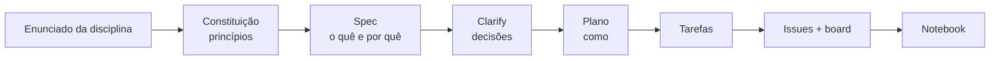

# 🎧 K-Means na prática: agrupando músicas do Spotify

[](https://colab.research.google.com/github/DataScience-Fatec-Projects/kmeans-musicas-spotify/blob/main/notebooks/aula_kmeans_spotify.ipynb)
[](LICENSE)
[](https://github.com/github/spec-kit)
[](https://github.com/orgs/DataScience-Fatec-Projects/projects/3)

Aula interativa em **Google Colab** sobre o algoritmo **K-Means** em Ciência de Dados. Ela agrupa
cerca de 90 mil músicas do Spotify pelas características de áudio (energia, dançabilidade,
valência, acústica…) e mostra que perfis de som existem nelas, com destaque para a música
brasileira.

> 🚧 **Em construção.** Projeto Final da disciplina ICD-004 Análise de Algoritmos (Fatec Jundiaí,
> Prof. Humberto Zanetti), com entrega em **24/11/2026**. O andamento está no
> [board do projeto](https://github.com/orgs/DataScience-Fatec-Projects/projects/3).

## O que a aula cobre

| Seção | Conteúdo |
|---|---|
| **I. Introdução** | Aprendizado não supervisionado, clustering, o K-Means **implementado do zero** passo a passo, **complexidade O(n·k·d·i)** e avaliação (inércia, cotovelo, silhueta) |
| **II. Ferramentas** | numpy, pandas, matplotlib, seaborn e o `KMeans` do scikit-learn |
| **III. Dados** | Dataset, dicionário de variáveis, limpeza (duplicatas, valores inválidos) e padronização com `StandardScaler` |
| **IV. Aplicação** | Escolha de k (cotovelo e silhueta), treino, visualização dos clusters e dos centroides |
| **V. Análise** | Perfil e nome de cada grupo, cruzamento com gêneros (sertanejo, pagode, samba, forró, MPB…), limitações e próximos passos |

Ao longo do notebook há células **🧪 Experimente**: blocos com um parâmetro para mudar e rodar de
novo.

## Dataset

[`maharshipandya/spotify-tracks-dataset`](https://huggingface.co/datasets/maharshipandya/spotify-tracks-dataset)
(Hugging Face, licença BSD). São 114 mil faixas de 114 gêneros, com características de áudio
coletadas pela API do Spotify. O notebook lê o CSV direto da URL pública, sem login e sem upload.

## Como usar

- **No Colab** (recomendado): clique no badge *Open in Colab* e depois em *Ambiente de execução →
  Executar tudo*.
- **Localmente**: veja [`quickstart.md`](specs/001-aula-kmeans-spotify/quickstart.md).

## Como este projeto é conduzido: Spec-Driven Development

O projeto usa o [spec-kit](https://github.com/github/spec-kit) do GitHub. Primeiro se escreve **o que**
a aula precisa ter e **por quê**, depois **como**, e só então o notebook. Cada tarefa vira uma issue
no board.



| Artefato | Para que serve |
|---|---|
| [`constitution.md`](.specify/memory/constitution.md) | 7 princípios inegociáveis: Colab-first, aula antes do código, reprodutibilidade… |
| [`spec.md`](specs/001-aula-kmeans-spotify/spec.md) | User stories (uma por seção), requisitos e critérios de sucesso |
| [`plan.md`](specs/001-aula-kmeans-spotify/plan.md) · [`research.md`](specs/001-aula-kmeans-spotify/research.md) | Decisões técnicas com evidência medida nos dados |
| [`estrutura-notebook.md`](specs/001-aula-kmeans-spotify/contracts/estrutura-notebook.md) | Contrato do notebook: títulos, regras de célula e variáveis por seção |
| [`tasks.md`](specs/001-aula-kmeans-spotify/tasks.md) | Tarefas `T0NN`, cada uma uma sub-issue no GitHub |
| [`sync_issues.py`](scripts/sync_issues.py) | Sincroniza o `tasks.md` com issues e sub-issues e com o Project |

## Estrutura

```text
notebooks/aula_kmeans_spotify.ipynb   # a aula (o produto)
specs/001-aula-kmeans-spotify/        # spec, plano, pesquisa, contrato, tarefas
.specify/                             # constituição e templates do spec-kit
.claude/skills/                       # comandos /speckit-* para o Claude Code
scripts/                              # validação do notebook e sincronização de issues
docs/enunciado.md                     # enunciado original
```

## Roadmap

- **M1 Dados e modelo** (13/11): base do notebook e Seções III e IV
- **M2 Aula completa** (20/11): Seções I, II e V
- **M3 Entrega** (24/11): revisão da rubrica, leitor-teste e link público
- **Depois da entrega** (backlog): app Streamlit para explorar os clusters e front-end Angular
  para o portfólio

## Contribuindo

Quer ajudar? Veja o [CONTRIBUTING.md](CONTRIBUTING.md): pegue uma issue em **Ready** no board, siga
o contrato do notebook e abra um PR.

## Autoria

- [Wellington Torres](https://github.com/WellingtonTorres): Ciência de Dados, Fatec Jundiaí

---

### About (English)

An interactive **Google Colab lesson on K-Means clustering** that groups ~90k Spotify tracks by
audio features (energy, danceability, valence, acousticness…). It covers a from-scratch
implementation with complexity analysis, the elbow method and silhouette score, cluster
interpretation and a focus on Brazilian music genres. The project is built with
**Spec-Driven Development** using GitHub's [spec-kit](https://github.com/github/spec-kit):
constitution → spec → plan → tasks → GitHub issues and sub-issues tracked on a public
[project board](https://github.com/orgs/DataScience-Fatec-Projects/projects/3).
Final project for an Algorithm Analysis course (Fatec Jundiaí, Brazil).

**Licença**: código sob [MIT](LICENSE). O dataset pertence aos seus autores (licença BSD).
